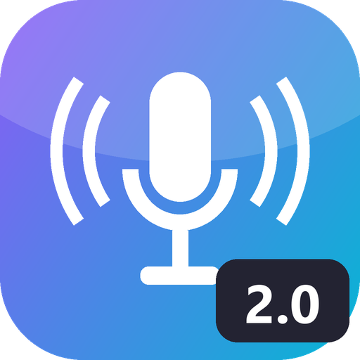
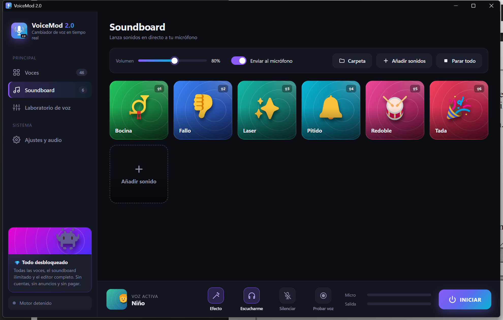
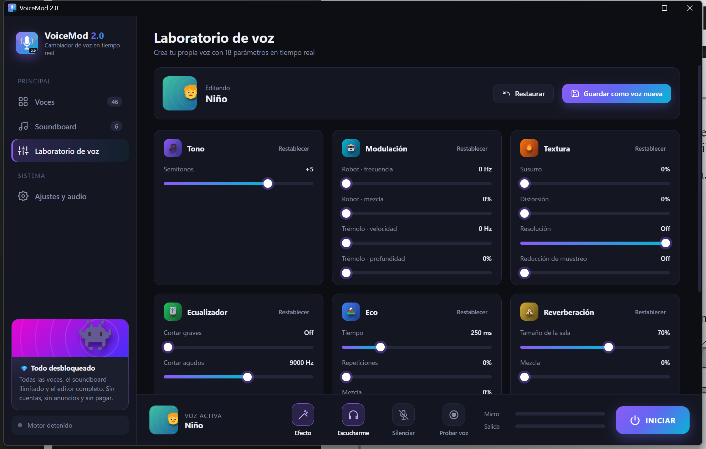



<h1 align="center">VoiceMod 2.0</h1>

Cambiador de voz en tiempo real para Windows, gratis y de código abierto. Todo desbloqueado.

 

---

## Funciones
- **46 voces** en 7 categorías: Humanas, Divertidas, Criaturas, Terror, Máquinas, Ambientes y tus propias voces.
- **Laboratorio de voz** con 18 parámetros que cambian en directo: tono, robot, susurro, distorsión, bitcrusher, ecualizador, trémolo, eco, reverb, puerta de ruido y volumen. Puedes guardar tus propias voces.
- **Soundboard ilimitado:** añade tus WAV y envíalos directamente a tu micrófono.
- **Visualizador de espectro** en directo y medidores de entrada y salida.
- **Probar voz:** grábate 4 segundos y escucha el resultado con el efecto actual.
- **Escucharme:** te oyes por los auriculares mientras hablas.
- **Atajos globales** que funcionan dentro de juegos y de Discord.
- Baja latencia: audio a 48 kHz procesado en bloques de 5 ms, con un motor DSP propio escrito en NumPy.

## Instalación
1. Instala [Python 3.11 o superior](https://www.python.org/downloads/).
2. `pip install -r requirements.txt`
3. Instala un cable de audio virtual, por ejemplo [VB-Cable](https://vb-audio.com/Cable/), que es gratis.
4. Haz doble clic en **`Iniciar VoiceMod 2.0.bat`**, o ejecuta `python app.py`.

## Usarlo en Discord, OBS o juegos
1. En la app, ve a **Ajustes y audio**. Elige tu micrófono y pon el cable como salida.
2. Pulsa **INICIAR**.
3. En Discord, abre *Voz y vídeo*. Pon como entrada **CABLE Output** y desactiva la supresión de ruido.

## Atajos globales
| Atajo | Acción |
|---|---|
| Ctrl+Alt+R | Voz aleatoria |
| Ctrl+Alt+V | Activar o desactivar el efecto |
| Ctrl+Alt+M | Silenciar el micrófono |
| Ctrl+Shift+1…9 | Lanzar un sonido |
| Ctrl+Shift+0 | Parar todos los sonidos |

## Estructura del proyecto
| Archivo | Contenido |
|---|---|
| `app.py` | Ventana (pywebview) y puente con la interfaz |
| `engine.py` | Motor de audio en tiempo real y efectos |
| `presets.py` | Definición de las voces |
| `make_art.py` | Genera el icono y las imágenes |
| `ui/` | Interfaz (HTML, CSS y JS) |

*Proyecto independiente. No está afiliado a Voicemod S.L.*
